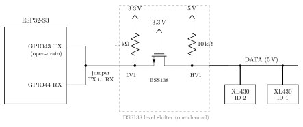
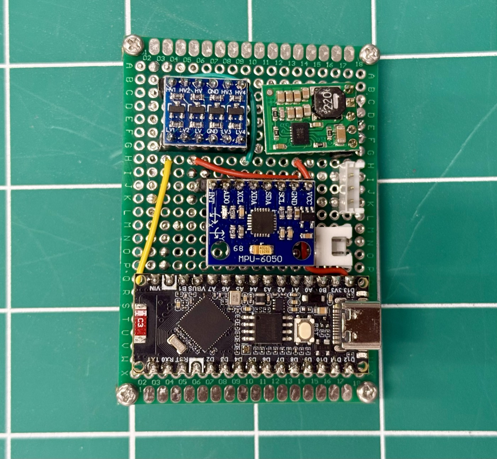
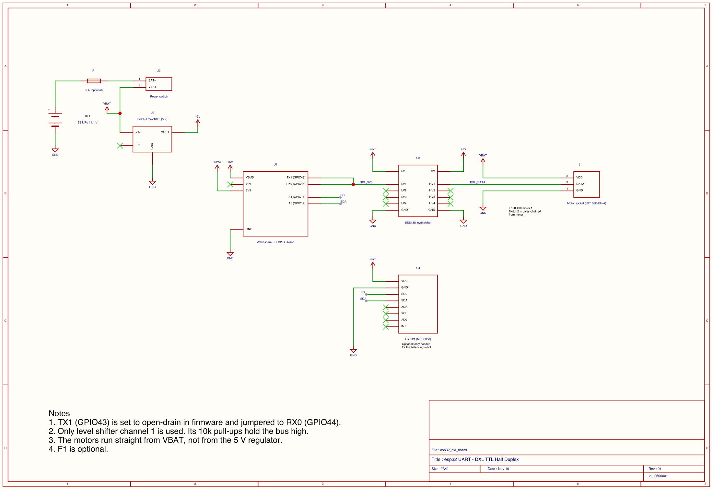
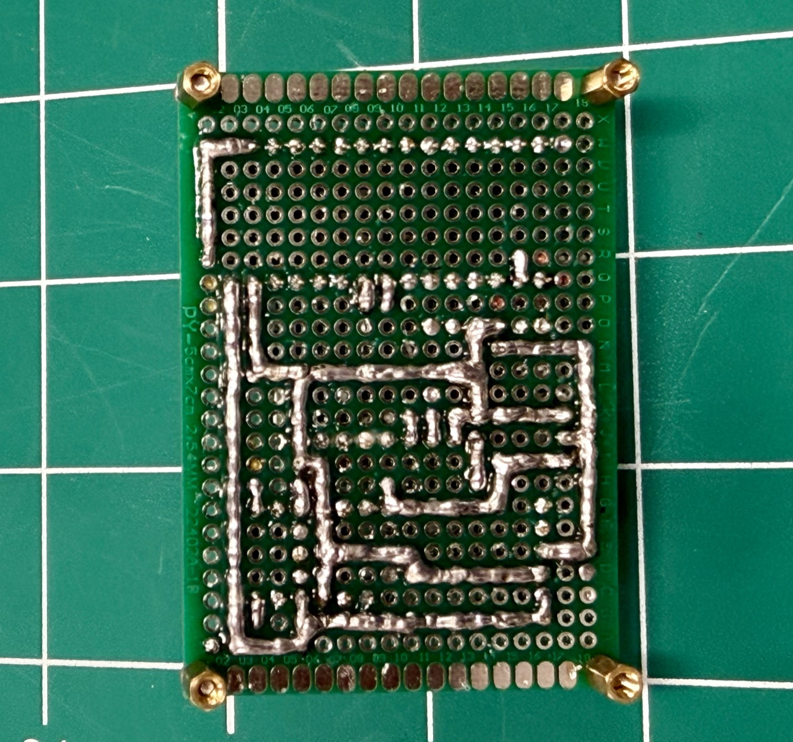
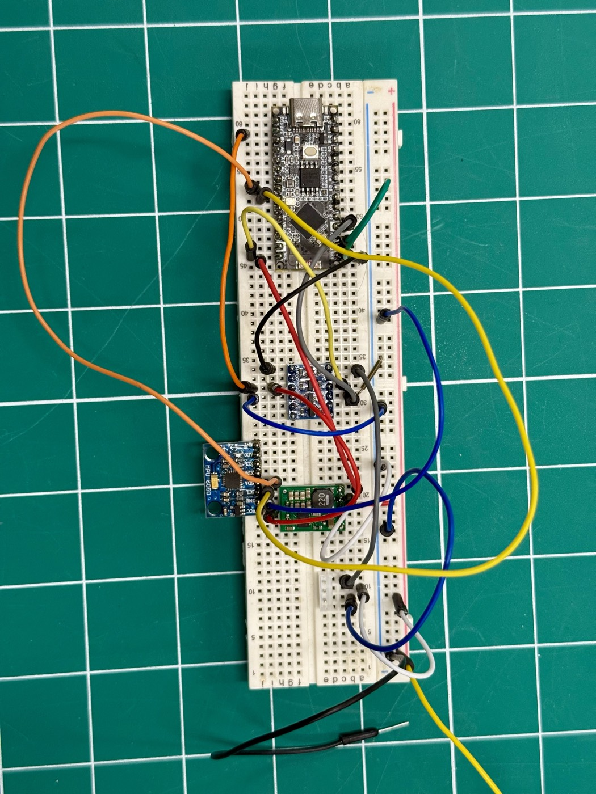
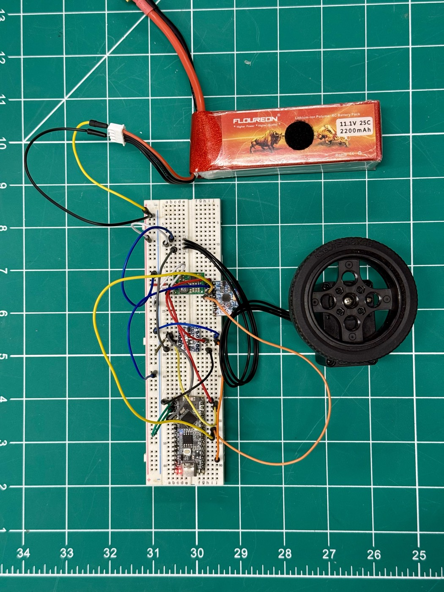
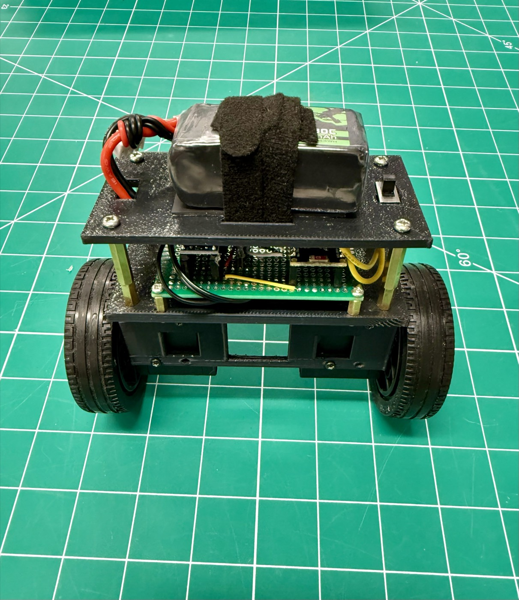

## Overview

For my [self-balancing robot](../self-balancing-robot/) I wanted to control two DYNAMIXEL
motors straight from an ESP32, without buying a ROBOTIS controller board. The catch is that
DYNAMIXEL motors talk over **one data wire**, and the ESP32's UART expects two (TX and RX).

It turns out you can make it work with a jumper wire, one line of setup code and a small
check in the driver. No extra chip. Here's how I did it.

## The problem


A normal UART has separate wires for sending and receiving. A **half-duplex** bus uses
one wire for both, so everyone has to take turns: the ESP32 sends a command to one motor ID,
stops, and then that motor replies on the same wire.

Two things get in the way:

1. The ESP32's TX pin holds the line high all the time, so it would block the motor's reply.
2. The motors use **5 V** signals, but the ESP32 is a **3.3 V** chip.

## The trick



1. **Jumper TX to RX.** Connect GPIO43 (TX) to GPIO44 (RX), so the two pins become one
   wire.
2. **Set TX to open-drain.** Now TX can only pull the line low. When it's not sending, it
   lets go, and the motor can use the wire to reply.
3. **Throw away the echo.** Since TX and RX are joined, the ESP32 hears everything it sends.
   After each command, the code reads those bytes back, checks they match, and drops them.
   Whatever comes after that is the motor's reply.

For the voltage, I used a **BSS138 level shifter** module between the ESP32 and the bus. It
just converts 3.3 V ↔ 5 V. Its built-in pull-up resistors also pull the line high when
nobody is talking, which open-drain needs.

A nice side effect of step 3: if the echo doesn't come back, I know it's a wiring problem
and not the motor.

## Building the board

<div class="split" markdown="1">
<figure markdown="0">
  
  <figcaption>My finished board on 50 × 70 mm perfboard.</figcaption>
</figure>
<div markdown="1">

The board has:

- **ESP32-S3 Nano** (bottom)
- **BSS138 level shifter** (top left)
- **5 V regulator** (top right), to run the ESP32 off the battery
- **Motor socket** (right edge, the upper white connector). The second motor is
  daisy-chained: the socket goes to motor 1, and motor 1's spare port goes to motor 2.
- **Switch connector** (right edge, the smaller lower one) for the power switch
- **MPU6050** (middle). Only needed for the robot; skip it if you just want the motors.

I put every module on female headers so I can swap one out if it dies.

</div>
</div>

| Part | Qty | Notes |
|------|-----|-------|
| Waveshare ESP32-S3-Nano | 1 | |
| BSS138 level shifter module | 1 | Only channel 1 is used |
| Pololu D24V10F5 5 V regulator | 1 | |
| DYNAMIXEL XL430-W250-T | 1–2 | With their 3-pin cables |
| JST B3B-EH-A 3-pin header | 1 | Motor socket |
| 3S LiPo battery and power switch | 1 each | |
| 5 A inline fuse | 1 | Optional |
| Perfboard, pin headers, wire | – | |
| U2D2 adapter | 1 | To set motor IDs from a PC |

[](images/schematic.png)
*Full schematic, drawn in EasyEDA. Click to enlarge, or [download the PDF](files/schematic.pdf).*

These are the connections that actually matter for the single wire:

| From | To |
|------|----|
| ESP32 TX1 (GPIO43) | ESP32 RX0 (GPIO44), the jumper |
| ESP32 TX1/RX0 | Level shifter LV1 |
| Level shifter HV1 | Motor socket DATA (pin 3) |
| ESP32 3V3 and regulator 5 V | Level shifter LV and HV |
| All grounds | Together |

<details markdown="1">
<summary>Full pin list</summary>

| Module | Pin | Goes to |
|--------|-----|---------|
| ESP32 | TX1 (GPIO43) + RX0 (GPIO44) | Joined, then to level shifter LV1 |
| ESP32 | VBUS | Regulator 5 V out |
| ESP32 | 3V3 | Level shifter LV, GY-521 VCC |
| ESP32 | A4 / A5 (GPIO11 / 12) | GY-521 SCL / SDA (optional) |
| ESP32 | VIN | Not connected |
| Level shifter | HV | Regulator 5 V out |
| Level shifter | HV1 | Motor socket DATA (pin 3) |
| Regulator | VIN | Battery +, after the switch |
| Motor socket | Pin 1 / 2 / 3 | GND / battery + (about 12 V) / DATA |
| Everything | GND | Common ground |

Check the level shifter's printed labels. The pin order is different between brands.

</details>

<details markdown="1">
<summary>Full wire list</summary>

| From | To | Wire |
|------|----|------|
| Battery + | (optional fuse) → switch connector → VBAT | 20–22 AWG red |
| Battery − | GND | 20–22 AWG black |
| VBAT | Regulator VIN, motor socket pin 2 | 20–22 AWG red |
| GND | Regulator GND, motor socket pin 1 | 20–22 AWG black |
| GND | ESP32 GND, level shifter GND, GY-521 GND | 26 AWG black |
| Regulator 5 V | Level shifter HV, ESP32 VBUS | 26 AWG orange |
| ESP32 3V3 | Level shifter LV, GY-521 VCC | 26 AWG purple |
| ESP32 TX1 | ESP32 RX0 (short jumper) | 26 AWG blue |
| ESP32 TX1/RX0 | Level shifter LV1 | 26 AWG blue |
| Level shifter HV1 | Motor socket pin 3 | 26 AWG cyan |
| ESP32 A5 / A4 | GY-521 SDA / SCL | 26 AWG pink / yellow |

Motor 2 plugs into motor 1's second port with a normal DYNAMIXEL cable.

</details>

<div class="split reverse" markdown="1">
<figure markdown="0">
  
  <figcaption>Back of the board.</figcaption>
</figure>
<div markdown="1">

A few things I learned while building it:

- Keep the TX–RX jumper and the wire to LV1 **short**.
- Run the motors **straight from the battery**, not the 5 V regulator. Each motor can pull
  about 1.4 A.
- Join **all the grounds**.
- **Turn the battery on before plugging in USB.** Otherwise the motors can lock up with a
  low-voltage error. It happened to both of mine once, and they needed a restart.
- Use a 3S battery, never 4S.

</div>
</div>

I tested everything on a breadboard with one motor before soldering anything:

<div class="media-row" markdown="0">
  <figure>
    
    <figcaption>Breadboard version.</figcaption>
  </figure>
  <figure>
    
    <figcaption>With the battery and a motor.</figcaption>
  </figure>
  <figure class="tall">
    <video src="videos/breadboard-test.mp4" autoplay muted loop playsinline></video>
    <figcaption>Driving the motor and reading the serial monitor.</figcaption>
  </figure>
</div>

## Setting up the motors

New DYNAMIXEL motors all ship as **ID 1 at 57600 bps**. If two of them are on the same wire,
they both answer at once, so each one needs its own ID first.

I used **DYNAMIXEL Wizard 2.0** with the **U2D2** adapter, one motor at a time:

| Setting | Left motor | Right motor |
|---------|------------|-------------|
| ID | 2 | 1 |
| Baud rate | 1 Mbps (1000000) | 1 Mbps (1000000) |
| Return delay | 0 | 0 |

## Get the source code

All the code is on my GitHub. Download it, build it with ESP-IDF and flash it.

**[Get the source code on GitHub →](https://github.com/luckysah)**

<!-- Change the link above to the repo URL, e.g. https://github.com/luckysah/repo-name -->

## The code

How it works:

- A normal UART on GPIO43 (TX) and GPIO44 (RX) at 1 Mbps.
- TX is set to **open-drain**, so it lets go of the wire when it's not sending:

  ```c
  gpio_od_enable(TX_PIN);   // TX lets go of the wire when idle
  ```

- Everything sent comes back on RX (the echo). The code checks the echo, then reads the
  motor's reply.
- Log output goes over USB, since GPIO43/44 are used for the motors.

## Testing

Before plugging anything in, check the board with a multimeter:

| Check | Expected |
|-------|----------|
| Battery + to GND (continuity, no battery) | **No beep** |
| ESP32 TX1 to RX0 (continuity) | Beep |
| Regulator output (battery on, only regulator plugged in) | 5.0 V |

Then flash **`hw_test`** from the repo. It checks the wiring and both motors and prints
PASS / FAIL.

## Results

| Test | Result |
|------|--------|
| Speed | **1 Mbps** |
| Ping + read one motor | **1.00 ms** |
| Read both motors + send both speeds | **≈1.2 ms** |

## What I'd try next

- A stronger pull-up (1 kΩ from DATA to 5 V) for a sharper signal.
- A 74LVC2G241 buffer chip with a direction pin, for higher speeds.

## Troubleshooting

| Problem | Check |
|---------|-------|
| Echo error | TX–RX jumper missing, or LV1 not connected |
| Motor doesn't answer | Battery on? Level shifter powered? Common ground? Right ID and baud rate? |
| Motor shows error 0x01 | Low-voltage lockout. Restart the motor, and turn the battery on before USB |
| ESP32 resets when the motors work hard | Weak 5 V supply or low battery |

## Files

- [Schematic (PDF)](files/schematic.pdf)
- [Source code on GitHub](https://github.com/luckysah)

## Where it's used

<div class="split compact panel" markdown="1">
<figure markdown="0">
  <a href="../self-balancing-robot/"></a>
</figure>
<div markdown="1">

#### [Two-Wheel Self-Balancing Robot](../self-balancing-robot/)

This board runs both wheel motors 250 times a second so the robot can balance by itself.

[View the project →](../self-balancing-robot/)

</div>
</div>
