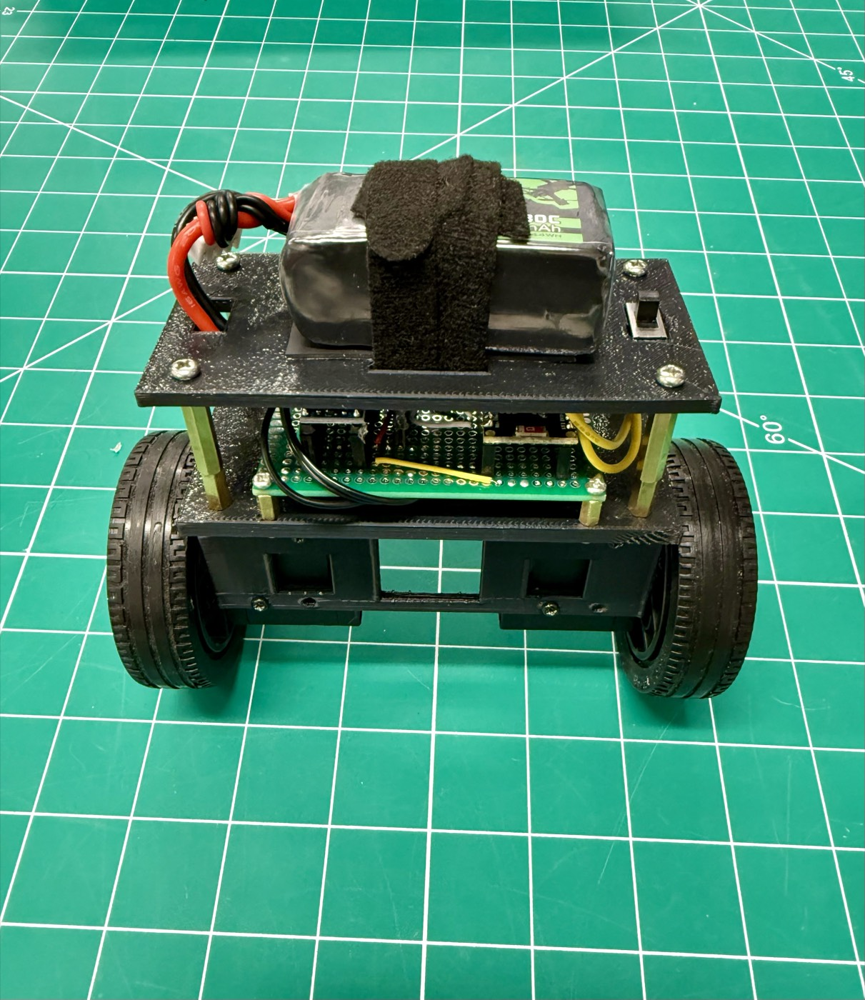
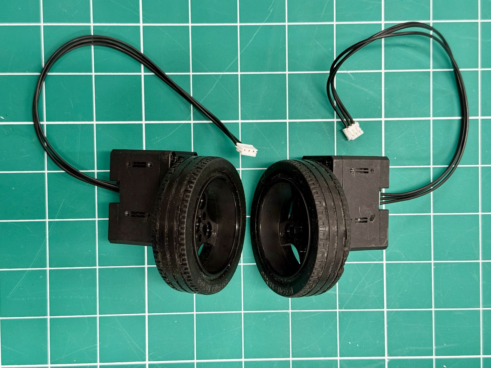
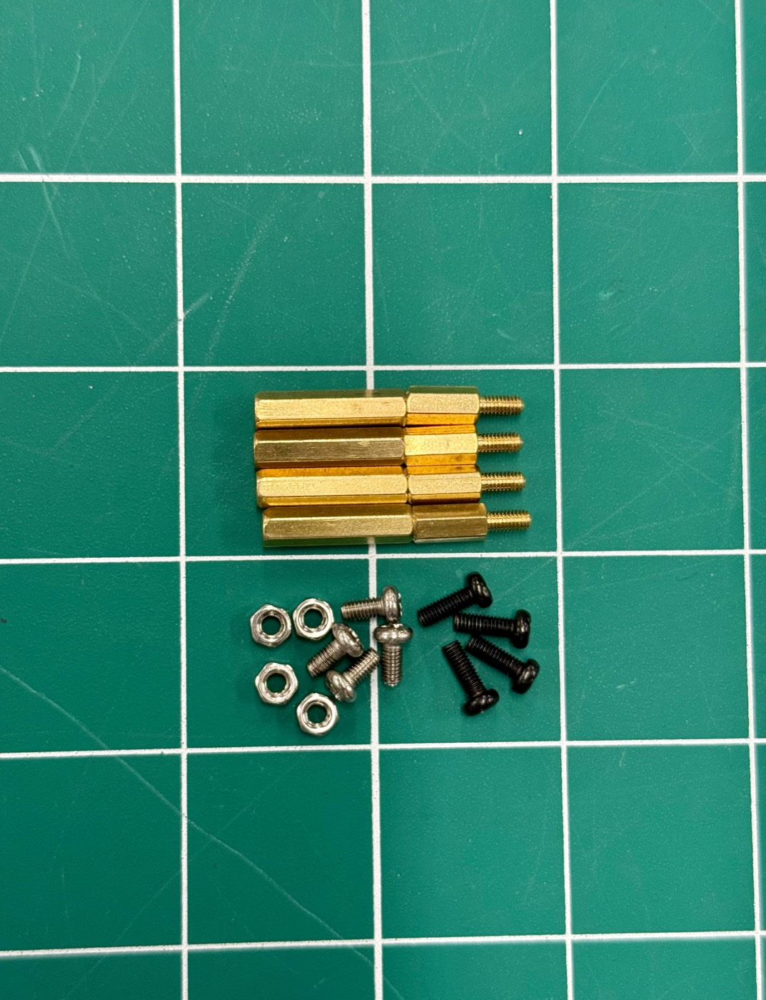
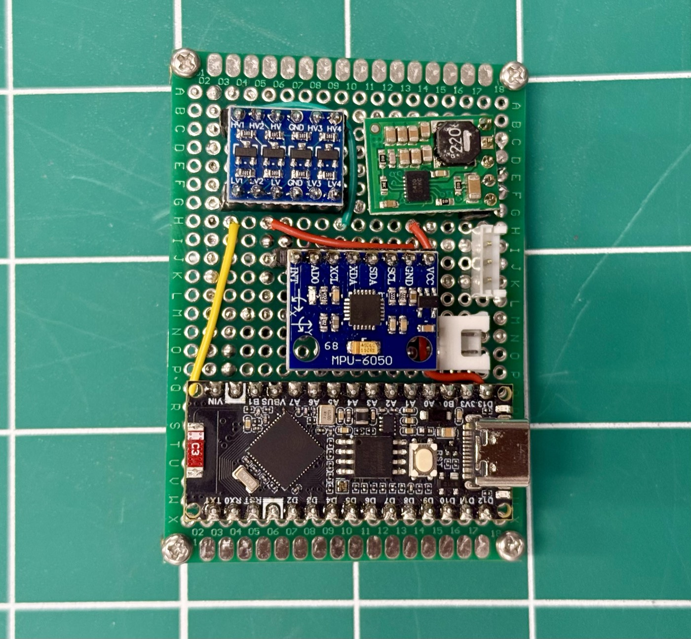
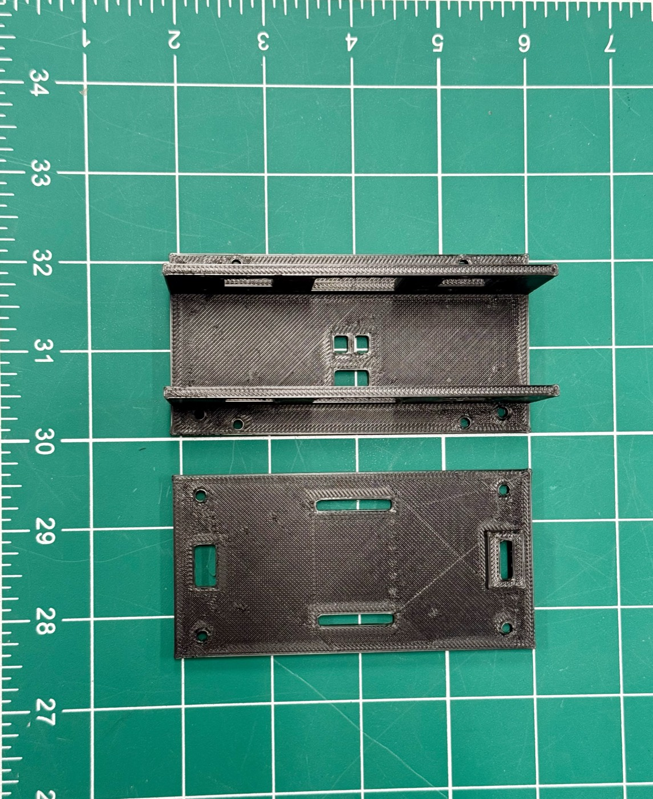
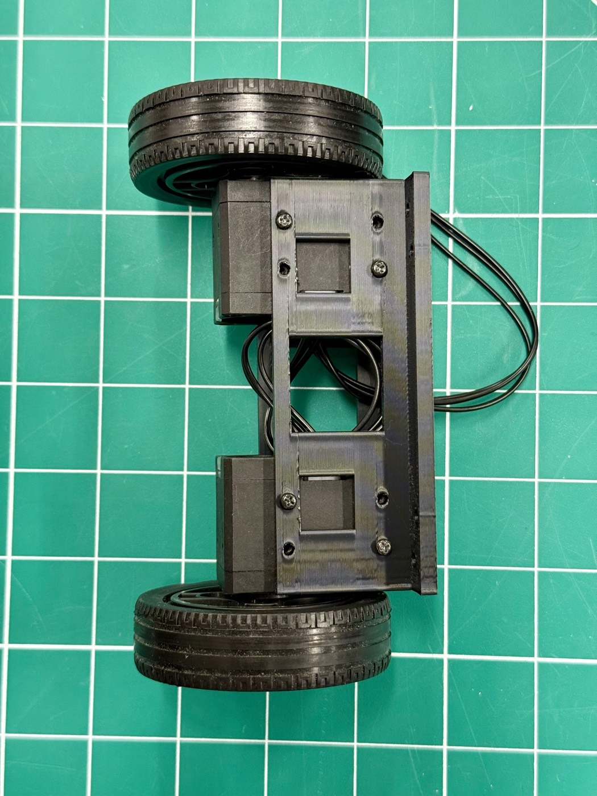
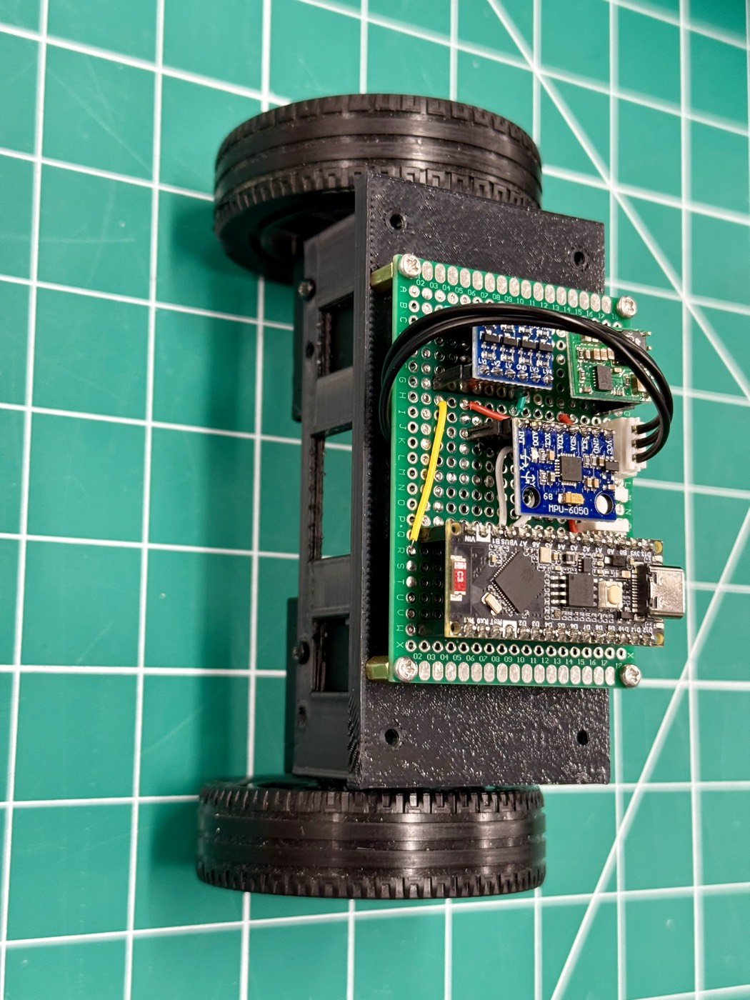
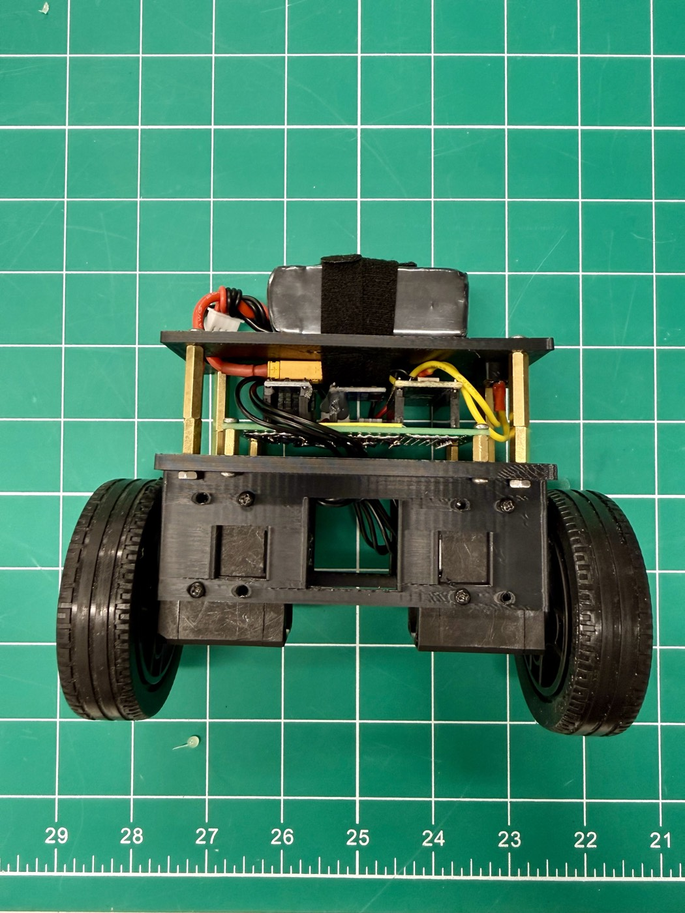

## Overview

This is a small two-wheeled robot that balances on its own, like a mini Segway. It uses Dynamixel Motors with ESP32.
The control board, and how the ESP32 talks to the motors over one wire, have their own guide: [Single-Wire Half-Duplex UART on the ESP32](../esp32-half-duplex-uart/).

The design aims to be simple to build:

- **No custom PCB.** The electronics are ready-made modules soldered onto a piece of perfboard.
- **The frame is two 3D-printed plates** ("decks").
- **No motor drivers or encoders.** The motors are two ROBOTIS DYNAMIXEL XL430-W250-T smart
  servos running in speed mode, so they measure and control their own speed.

**How it balances:** an MPU6050 motion sensor measures how far the robot is leaning. An
ESP32-S3 reads it 250 times per second and drives the wheels under the robot to catch it
before it falls.

**What's included:** firmware for the ESP32 (written with ESP-IDF), a Python control app
with keyboard driving, live PID tuning and live plots, and test programs that check the
wiring before you try to balance.


*The finished robot.*

## How the control works

The controller is three loops, one inside the other:

```
Target speed (W/S keys)
  → SPEED LOOP (Speed P, I) ............ decides how far to lean
    → BALANCE LOOP (P, I, D) ............ moves the wheels to hold that lean
      → MOTOR SPEED LOOP (inside each XL430) ... makes the wheels reach that speed
```

- The tilt angle comes from the MPU6050: gyro and accelerometer readings are combined with a
  **complementary filter** (98 % gyro, 2 % accelerometer).
- At power-up the robot calibrates the gyro. **Keep it completely still** for a moment after
  switching on. If it moves, the log shows "robot moved - retrying" and it waits.

Built-in safety:

- Balancing only starts if the robot is within **15°** of upright.
- The motors switch off if it tilts beyond **35°** (fallen).
- If the app stops sending for **0.5 s** (Wi-Fi lost), the robot stops driving.

## Parts list

### Electronics

| Part | Qty | Notes |
|------|-----|-------|
| ESP32 control board | 1 | ESP32-S3, level converter, regulator, motor sockets. Parts list and build in the [half-duplex UART guide](../esp32-half-duplex-uart/) |
| GY-521 module (MPU6050) | 1 | Tilt sensor: gyroscope + accelerometer; plugs into the control board |
| ROBOTIS DYNAMIXEL XL430-W250-T | 2 | Wheel motors, each with a 3-pin ROBOTIS cable |

### Power

| Part | Qty | Notes |
|------|-----|-------|
| 3S LiPo battery, 1300 mAh | 1 | 11.1 V nominal, 12.6 V full, ~30 × 75 × 25 mm, ~120 g. **3S only, never 4S** |
| Battery connector (e.g. XT30 pair) | 1 | Female on the robot side |
| Inline fuse holder + 5 A fuse | 1 | On the battery + wire |
| Small switch rated 5 A or more | 1 | After the fuse; the Deck 2 pocket fits a 13 × 7 × 6.5 mm flat switch |
| LiPo voltage alarm (buzzer) | 1 | Plugs into the balance lead; beeps when the battery is low |
| LiPo balance charger | 1 | For charging the 3S pack |

### Wheels and frame

| Part | Qty | Notes |
|------|-----|-------|
| ROBOTIS TurtleBot3 wheel + TR-66 tyre | 2 | 66 mm diameter; bolts straight onto the XL430 horn; includes M2 × 4 screws |
| Deck 1 – Motor Base (3D printed) | 1 | 104 × 52 × 4 mm plate with side skirts that clamp both motors; holds the control board |
| Deck 2 – Battery deck (3D printed) | 1 | 104 × 52 × 3 mm plate with strap slots and a switch pocket |


*The two DYNAMIXEL XL430 motors with their TurtleBot3 wheels.*

<details markdown="1">
<summary>Screws, standoffs and fixings</summary>

| Part | Qty | Use |
|------|-----|-----|
| M2 × 6 screws | 16 | Deck 1 skirts → motor sides (8 per motor) |
| M2 × 4 PHS screws | 8 | Wheel → motor horn (come with the TB3 wheels) |
| M3 × 30 hex standoffs, female-female | 4 | Deck 1 → Deck 2 |
| M3 × 6 screws | 8 | Fix the standoffs to both decks |
| M3 × 6 spacers (nylon or brass) | 4 | Lift the control board off Deck 1 |
| M3 screws (length to suit spacers) | 8 | Fix the control board and spacers |
| M3 nuts | 4 | Only if your spacers are not threaded |
| 20 mm hook-and-loop (Velcro) strap | 1 | Holds the battery on Deck 2 |
| Small zip ties | ~5 | Tidy the motor cables |
| Small screws / stiff spacers for the GY-521 | 2 | The MPU6050 must be fixed firmly; no foam tape |


*Standoffs, screws and nuts.*

</details>

### Tools

- Everything for the control board (see the [half-duplex UART guide](../esp32-half-duplex-uart/))
- Small Phillips screwdriver (M2), hex keys or screwdriver for M3
- Small pliers or a 5.5 mm nut driver for the standoffs
- 3D printer (PLA or PETG)
- Hot glue or tape for tidying wires (not for the sensor)
- USB-C **data** cable and a PC (Windows, Linux or Mac) with Wi-Fi

## Build guide

### Step 1: Build the control board

The control board (ESP32-S3, level converter, regulator, MPU6050 and motor sockets) and the
motor setup have their own guide: **[Single-Wire Half-Duplex UART on the ESP32](../esp32-half-duplex-uart/)**.
Follow it up to the end of its Step 4 (connection checks), then come back here.

For this robot, set the motors up as follows:

- **Left motor = ID 2, right motor = ID 1**
- Baud rate 1 Mbps (register value 3)
- Operating mode 1 (velocity mode)

Fit the **GY-521 (MPU6050)**; the robot needs it to measure its tilt.


*The control board, built with the [half-duplex UART guide](../esp32-half-duplex-uart/).*

### Step 2: Run the hardware test

This test checks the whole board, the sensor and both motors before you assemble the robot.

1. Switch off. Plug in all modules (check orientation) and both motors.
2. Switch the battery on, then connect the ESP32 to the PC by USB.
3. Flash the `hw_test` firmware (see Step 5) and open the monitor.

It prints a PASS / WARN / FAIL report covering the ESP32, the MPU6050, the bus echo (TX–RX
bridge), both motors, the battery voltage, and each wheel (it spins them slowly, so keep the
wheels off the table). You want **0 FAIL**. A WARN about the accelerometer offset is normal;
software calibration fixes it.

<details markdown="1">
<summary>Common hardware test failures</summary>

| Message | Check |
|---------|-------|
| MPU6050 found on other pins | SDA and SCL are swapped |
| No MPU6050 | GY-521 VCC must go to 3V3; check GND |
| DATA held low | Level converter power, or GND and DATA swapped at a motor socket |
| Echo FAIL | TX–RX bridge missing, or LV1 not connected to it |
| No motor answers | Battery on? 5 V on HV? HV1 to pin 3? Common ground? Wrong ID or baud rate? |
| Motor found at another baud | Set it to 1 Mbps (value 3) again |
| Reset reason "BROWNOUT" | Weak 5 V supply; check regulator wiring |

</details>

### Step 3: Print the frame

- Export Deck1_MotorBase and Deck2_Battery from Autodesk Inventor as STL (File → Save As →
  Save Copy As → STL).
- Material: PETG or PLA. Settings: 4 walls, 40 % infill, 0.2 mm layers.
- **Deck 1:** print flat with the side skirts pointing up. No supports.
- **Deck 2:** print flat. The switch pocket hangs underneath, so print it upside down or with
  supports under the pocket. Deck 2 can also be laser-cut from 3 mm acrylic or plywood
  (without the pocket).
- If the screws don't fit, clean the holes by hand with a 2 mm and 3 mm drill bit.


*Deck 1, the motor base with side skirts (top), and Deck 2, the battery deck (bottom).*

### Step 4: Assemble the robot

1. **Set up the motor IDs first** (Step 1: left = 2, right = 1, 1 Mbps, velocity mode).
2. **Motors to Deck 1.** The two XL430s hang under Deck 1 with the horn end down and the horn
   facing outward (left motor's horn faces left, right motor's faces right). Slide them
   between the skirts and fix them with M2 × 6 screws through the skirts (8 per motor).
3. **Wheels.** Screw each TB3 wheel onto its motor horn with 4 × M2 × 4 screws.
4. **Motor cables.** Plug a ROBOTIS cable into each motor and run it up through the cable hole
   in Deck 1. Zip-tie the cables to the middle bar so they can't touch the wheels.

   
   *Motors and wheels mounted on Deck 1.*

5. **Control board.** Mount it on top of Deck 1 with 4 × M3 × 6 spacers and M3 screws. Plug the
   motor cables into J1 and J2 (each motor has its own ID, so either socket works).
6. **MPU6050 placement (very important for balancing):**
   - Mount it **flat, directly above the wheel axle**, centred front-to-back.
   - Line one of its edges up parallel to the axle.
   - Note which printed arrow (X or Y) points along the axle; you'll choose the axis in the
     app later.
   - Fix it **firmly** with screws or stiff spacers. **Not foam tape:** foam lets it vibrate
     and the robot will shake.

   
   *Control board mounted on Deck 1.*

7. **Standoffs.** Screw the 4 × M3 × 30 standoffs onto Deck 1 with M3 × 6 screws from below.
8. **Deck 2.** Fit the power switch into its pocket (pins down through the slot). Screw Deck 2
   onto the standoffs with 4 × M3 × 6 screws. Put the battery on Deck 2, **centred
   front-to-back**, and strap it down through the slots. Pass the battery lead through the
   lead slot.
9. Plug the LiPo voltage alarm into the battery's balance lead.
10. **Final check:** spin each wheel by hand. Nothing should rub and no wire should touch a
    wheel. Gently shake the robot; nothing should rattle.

> Keep the battery centred front-to-back. Any offset makes the robot lean and drift.


*Fully assembled.*

### Step 5: Install the software and flash the firmware

The software has these parts:

| Folder | What it is |
|--------|------------|
| `balance/` | Main firmware: Wi-Fi, 250 Hz balance loop, driving, live tuning |
| `hw_test/` | Hardware test with a PASS/FAIL report |
| `teleop/` | Drive the wheels from the keyboard over USB (no balancing); also sets motor directions |
| `bus_bench/` | Finds the fastest reliable motor baud rate and measures wheel response |
| `pin_scan/` | Wiring debug tool |
| `components/` | Shared drivers (DYNAMIXEL bus, MPU6050) |
| `ui/` | PC control app (Python) |

**Install the tools (once):**

1. Install **ESP-IDF v6.1** using Espressif's getting-started guide
   (docs.espressif.com → ESP-IDF → Get Started → ESP32-S3).
2. Install **Python 3.10 or newer**. On Windows, tick "Add Python to PATH".
3. Install the app's library:

   ```
   pip install PyQt6
   ```

**Flash the hardware test.** Switch the battery on first, then plug the ESP32 into the PC by
USB (battery and USB together is safe). Find the port (Windows: Device Manager → Ports, e.g.
COM5; Linux: `/dev/ttyACM0`). In the ESP-IDF terminal:

```
cd Software/hw_test
idf.py build
idf.py -p COM5 flash monitor
```

Replace `COM5` with your port. You want 0 FAIL. Exit the monitor with Ctrl+].

**Flash the balance firmware:**

```
cd Software/balance
idf.py build
idf.py -p COM5 flash
```

Unplug USB. The robot now runs from the battery alone. Wi-Fi settings (network name,
password, or joining your home Wi-Fi) can be changed with `idf.py menuconfig` → "Balance
robot".

### Step 6: Connect the control app

1. Switch the robot on and keep it still for a second.
2. On the PC, join the robot's Wi-Fi network: **BalanceBot**, password **balance123** (no
   internet). Change these in `menuconfig` for your own build.
3. Start the app:

   ```
   cd Software/ui
   python robot_ui.py
   ```

4. Click **Find robot** (or **Connect** to `192.168.4.1`). The app reads the robot's saved
   settings into the boxes.
5. If it can't connect, allow Python through the Windows firewall (private networks).

**Modes**

| Mode | Use |
|------|-----|
| Off | Motors free. For setup and calibration |
| Manual drive | Wheels follow the keys, no balancing. Robot lying down or on a stand |
| Balance | The robot balances; W/A/S/D drive it |

<details markdown="1">
<summary>All app controls and plots</summary>

| Control | What it does |
|---------|--------------|
| W / S | Forward / backward |
| A / D | Turn left / right (combine with W/S to curve) |
| Space / Esc | **Emergency stop** (Off) |
| Speed slider | Target speed in Balance mode. Start at 5–10 rpm |
| Turn slider | Turning speed |
| Tuning boxes | Changes apply instantly |
| IMU axis / invert | Which sensor axis is pitch, and its sign |
| Set balance angle = now | Stores the current tilt as "upright" |
| Calibrate gyro | Measures the gyro offset (robot still, mode Off) |
| Load from robot | Shows the values the robot is using |
| Save on robot | Stores all settings permanently |
| Motor bus check | Pings both motors; results in the log |

The app window must be focused (clicked) for the keys to work.

**Top plot (tilt, degrees):** blue = tilt from the balance angle; orange = target lean from
the speed loop.
**Bottom plot (wheel speed, rpm):** orange = wheel speed asked for by the balance loop;
green = measured left wheel; red = measured right wheel.

Hover over a plot to read exact values. Scroll or drag to go back through the last 5 minutes.
"Pause" freezes the view (recording continues), "Window" sets the time span (5–60 s), and
"Clear" empties the history.

</details>

### Step 7: Tune the robot

Tune from the inside out: **setup → Balance P → Balance D → Speed P → Speed I → balance
angle.** Hold the robot over something soft (a bed or cushion). Space stops everything at
any time.

| Setting | What it does | Too low | Too high |
|---------|--------------|---------|----------|
| Balance P | How hard the wheels react to tilt. **The main gain** | Tips over slowly | Fast, violent shaking |
| Balance D | Reacts to how fast it's tipping; damps rocking | Keeps rocking | Buzzing, noisy jitter |
| Balance I | Removes a constant lean. Usually 0 | – | Slow, growing wobble |
| Speed P | Leans the robot to reach the target speed | Drifts away; W/S do nothing | Slow sway every 1–2 s |
| Speed I | Holds its spot and comes back after a push | Slowly creeps one way | Slow sway that keeps growing |
| Balance angle | Tilt where the weight is exactly over the wheels | Wrong one way: drives forward; the other way: drives backward | |
| Motor vel. P / I | The motors' own speed control. Keep at 400 / 3840 | Wheels lag, feels soft | Wheels buzz |

1. **Setup (mode Off, every session).**
   - Tilt the robot forward by hand: "Pitch" must go **positive**. If it goes negative, tick
     "invert". If it barely changes, switch the "IMU axis".
   - Keep it perfectly still and press **Calibrate gyro**.
   - Hold it where it feels weightless (balanced over the wheels) and press **Set balance
     angle = now**.
   - Enter the start values: Balance P = 60, I = 0, D = 3; Speed P = 0, Speed I = 0;
     Motor vel. P = 400, I = 3840.
2. **Balance P.** Hold the robot upright, press **Balance**, and raise P in steps of about 20.
   Too low: it tips over slowly. Right: it catches itself but rocks quickly. Too high: violent
   shaking. Settle about 20 % below the point where shaking starts.
3. **Balance D.** Raise in steps of 0.5–1 until the rocking dies out quickly. If the motors
   buzz, back off. After this you can often raise P a little more.
4. **Balance I.** Leave it at 0. Only try 0.5–2 if the robot stands at a constant lean after
   the speed loop is tuned.
5. **Speed P.** The robot now stands but slowly rolls away. Start at 0.05 and raise in steps of
   0.02 until it stays roughly in place and responds to W/S. A slow sway means it's too high.
6. **Speed I.** Start at 0.02 and raise in steps of 0.01 until it holds its spot and returns
   after a gentle push. A growing sway means it's too high.
7. **Fine-tune the balance angle.** If it always rolls one way: drives forward → lower the
   angle by 0.2–0.5°; drives backward → raise it.
8. **Save.** Press **Save on robot**; unsaved values are lost at power off.

> **Values that worked on this robot** (reference only; every build differs):
> Balance P = 140, Balance D = 8, Speed P = 0.08, Speed I = 0.02.
>
> If values that worked once feel worse later: the balance angle may have been set slightly
> differently, the gyro may have been calibrated while the robot moved, or the battery is low
> (charge it below ~10.5 V).

## Driving speed

- The motors top out at about **55 rpm** (~0.2 m/s with these wheels).
- Balancing needs spare wheel speed to catch the robot, so keep the drive speed around
  **30–35 rpm**. Raise the Speed slider step by step (15, 20, 25, 30).
- Watch the orange line on the speed plot: if it hits ±55, the motors are maxed out and the
  robot will fall.
- Reaches speed slowly → raise Speed P by 0.02. Never quite reaches it → raise Speed I a
  little.

## Troubleshooting

| Symptom | Fix |
|---------|-----|
| App can't find the robot | Joined "BalanceBot"? Battery on? Try Connect 192.168.4.1. Allow Python through the firewall |
| Keys do nothing | Click the app window; choose Manual drive or Balance |
| Falls immediately, faster the more it leans | Pitch sign is wrong: redo setup (invert / axis) |
| Falls slowly | Raise Balance P |
| Fast shaking | Lower P or raise D |
| Buzzing / jitter | Lower D or Motor vel. P. Check the sensor is screwed down firmly |
| Slow sway | Lower Speed P / Speed I |
| Always drives one way | Adjust the balance angle or raise Speed I |
| W/S do nothing in Balance | Set Speed P to about 0.05 |
| "Rate" not ~0 when still | Mode Off, keep still, Calibrate gyro |
| "Refused" | Hold within 15° of upright before pressing Balance |
| "Motor not answering" | Switch the battery off and on; use Motor bus check |
| Robot resets when motors work hard | Battery low or weak 5 V wiring |

## Safety

- **LiPo batteries can catch fire** if shorted, punctured or over-discharged. Always use the
  fuse, the voltage alarm and a proper balance charger. Never leave a charging LiPo
  unattended.
- A fully charged 3S pack (12.6 V) is slightly above the XL430's 12 V rating. This is common
  practice (ROBOTIS TurtleBot3 does the same), but **never use a 4S pack**.
- Always let the robot sit still for a second after switching on (gyro calibration).
- Keep fingers clear of the wheels in Balance and Manual drive modes.

<!-- Add links when ready, e.g.:
## Files
- [Source code on GitHub](https://github.com/luckysah/...)
- [CAD / STL files](files/...)
-->

*Credits: DYNAMIXEL protocol by ROBOTIS; firmware built on ESP-IDF by Espressif.*
