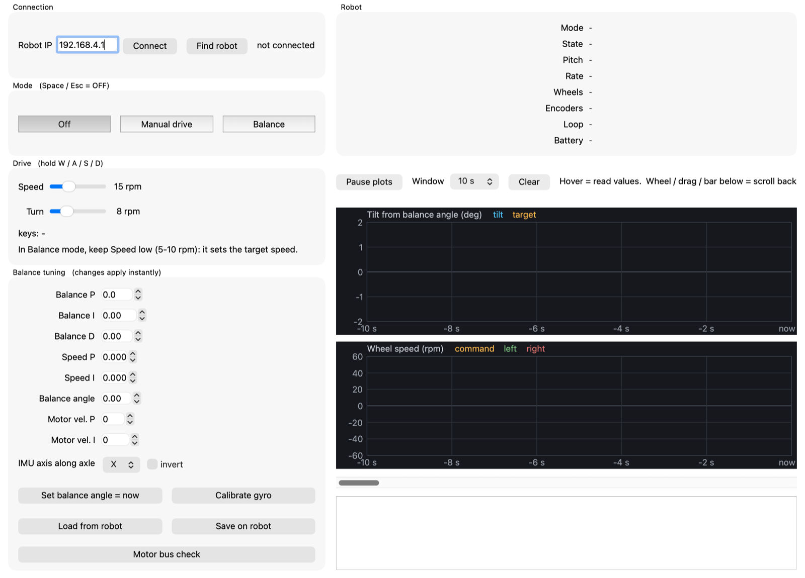

## Overview

<div class="split" markdown="1">
<figure markdown="0">
  
  <figcaption>The finished robot.</figcaption>
</figure>
<div markdown="1">

A two-wheeled robot that stands up on its own and can be driven around from a PC.

It's designed to be easy to build:

- **No custom PCB.** Ready-made modules on a piece of perfboard.
- **Two 3D-printed plates** for the frame.
- **No motor drivers or encoders.** The DYNAMIXEL motors control their own speed.

**How it balances:** a motion sensor (MPU6050) measures how far the robot is leaning. The
ESP32 reads it 250 times a second, and a simple **PID controller** moves the wheels under the
robot to catch it before it falls.

</div>
</div>

## See it in action

<blockquote class="twitter-tweet" data-dnt="true" data-align="center">
<a href="https://x.com/LuckySah22/status/2115930242686816372">View the post on X</a>
</blockquote>
<script async src="https://platform.twitter.com/widgets.js" charset="utf-8"></script>

### Video tutorial

<!-- When the YouTube video is up, replace the placeholder div below with:
<iframe src="https://www.youtube.com/embed/VIDEO_ID" title="Self-balancing robot build tutorial" allowfullscreen></iframe>
-->
<div class="media-placeholder">Full build video coming soon on YouTube</div>

## What you need

### Electronics

| Part | Qty | Notes |
|------|-----|-------|
| ESP32 control board | 1 | Build it with the [half-duplex UART guide](../esp32-half-duplex-uart/), including the MPU6050 |
| DYNAMIXEL XL430-W250-T | 2 | Wheel motors, with their 3-pin cables |
| 3S LiPo battery, 1300 mAh | 1 | 11.1 V. **3S only, never 4S** |
| XT30 connector and power switch | 1 each | |

### Frame

| Part | Qty | Notes |
|------|-----|-------|
| TurtleBot3 wheel + TR-66 tyre | 2 | 66 mm; bolts straight onto the motor |
| Deck 1, motor base (3D printed) | 1 | Holds both motors and the control board |
| Deck 2, battery deck (3D printed) | 1 | Holds the battery and the switch |

<details markdown="1">
<summary>Screws and fixings</summary>

| Part | Qty | Use |
|------|-----|-----|
| M2 × 6 screws | 16 | Deck 1 → motors (8 per motor) |
| M2 × 4 screws | 8 | Wheels → motors (come with the wheels) |
| M3 × 30 brass standoffs | 4 | Deck 1 → Deck 2 |
| M3 × 6 screws | 8 | Standoffs to both decks |
| M3 spacers, 6 mm tall | 4 | Control board to Deck 1 |
| M3 screws | 4 | Control board |
| 20 mm Velcro strap | 1 | Battery |
| Small zip ties | ~5 | Motor cables |


No brass standoffs? Print the standoff file from the
[GitHub repo](https://github.com/luckysah/Two-Wheel-Self-Balancing-Robot) and use those instead.

</details>

**Tools:** soldering iron, small screwdrivers (M2, M3), 3D printer, USB-C data cable, a PC with Wi-Fi.

## Build steps

### Step 1: Build the control board

<div class="split" markdown="1">
<figure markdown="0">
  
  <figcaption>The control board.</figcaption>
</figure>
<div markdown="1">

The board and the motor setup have their own guide:
**[Single-Wire Half-Duplex UART on the ESP32 →](../esp32-half-duplex-uart/)**

Build it there, run its `hw_test`, then come back here. For this robot:

- Fit the **MPU6050**. The robot needs it to measure its tilt.
- Set the motors to **left = ID 2, right = ID 1**, at **1 Mbps**.

</div>
</div>

### Step 2: Print the frame

<div class="split" markdown="1">
<figure markdown="0">
  
  <figcaption>Deck 1 (top) and Deck 2 (bottom).</figcaption>
</figure>
<div markdown="1">

Print the two deck files from the
[GitHub repo](https://github.com/luckysah/Two-Wheel-Self-Balancing-Robot):

- **Deck 1**, the motor base
- **Deck 2**, the battery deck

</div>
</div>

### Step 3: Mount the motors and wheels

<div class="split" markdown="1">
<figure markdown="0">
  
  <figcaption>Motors and wheels on Deck 1.</figcaption>
</figure>
<div markdown="1">

1. Slide both motors under Deck 1, horn end down, horns facing outward.
2. Screw them in through the side walls (M2 × 6, 8 per motor).
3. Screw a wheel onto each motor horn (M2 × 4).
4. Run the motor cables up through the hole in Deck 1 and zip-tie them so they can't touch
   the wheels.

</div>
</div>

### Step 4: Mount the control board

<div class="split" markdown="1">
<figure markdown="0">
  
  <figcaption>Control board on Deck 1.</figcaption>
</figure>
<div markdown="1">

1. Mount the board on Deck 1 with the four M3 spacers.
2. Plug motor 1 into the board's socket, and motor 2 into motor 1's spare port.
3. Make sure the **MPU6050** sits flat and can't move. I added a little hot glue to hold it
   tight, so it doesn't shake.

</div>
</div>

### Step 5: Add the battery deck

<div class="split" markdown="1">
<figure markdown="0">
  
  <figcaption>Fully assembled.</figcaption>
</figure>
<div markdown="1">

1. Screw the four M3 × 30 standoffs onto Deck 1.
2. Fit the power switch into Deck 2's pocket, then screw Deck 2 onto the standoffs.
3. Strap the battery on, **centred front to back**. Any offset makes the robot drift.
4. Spin each wheel by hand. Nothing should rub or rattle.

</div>
</div>

### Step 6: Flash the firmware

Get the code from GitHub. You need **ESP-IDF** and **Python 3.10+**.

**[Get the source code on GitHub →](https://github.com/luckysah/Two-Wheel-Self-Balancing-Robot)**

Switch the battery on and plug the ESP32 into your PC. Run each command from the repo folder.

**1. Set the wheel direction (once).** The motors face opposite ways, so one of them has to
be reversed. Flash `teleop`, then press `w` in the monitor. If a wheel spins backward, press
`L` (left) or `R` (right) to reverse it. Space stops the wheels. The setting is saved in the
motor.

```
cd teleop
idf.py build flash monitor
```

**2. Flash the robot firmware:**

```
cd balance
idf.py build flash
```

Unplug USB. The robot now runs on the battery.

### Step 7: Use the app

1. Switch the robot on and **keep it still for a second** while the sensor calibrates.
2. On your PC, join the Wi-Fi network **BalanceBot** (password **balance123**).
3. Start the app:

   ```
   pip install -r ui/requirements.txt
   python ui/robot_ui.py
   ```

4. Click **Find robot**. Once it says "connected", the boxes fill with the robot's saved
   values.


*The control app.*

| Part of the app | What it's for |
|-----------------|---------------|
| **Mode** | **Off** (motors free), **Manual drive** (drive without balancing, robot lying down) or **Balance**. Space or Esc switches to Off at any time |
| **Drive** | Hold **W / A / S / D** to drive. The sliders set the speed. In Balance mode keep Speed low (5–10 rpm) |
| **Balance tuning** | The PID values. Changes apply instantly; press **Save on robot** to keep them |
| **Robot** | Live tilt, wheel speed and battery voltage. Shows "LOW" when the battery needs charging |
| **Plots** | Top: how far the robot is leaning. Bottom: wheel speed. Hover to read values, **Pause plots** to freeze them |
| **Log** (bottom) | Messages from the robot, like "Balance refused" or "motor not answering" |

Click on the app window first, or the keys won't work.

### Step 8: Tune it

Hold the robot over something soft. Press **Space** to stop at any time.

1. **Setup (mode Off):** tilt the robot forward. "Pitch" should go up; if it goes down, tick
   **invert**. Keep it still and press **Calibrate gyro**. Hold it where it feels balanced
   and press **Set balance angle = now**.
2. **Balance P:** press **Balance** and raise P in steps of 20 until it catches itself. If it
   shakes hard, back off about 20 %.
3. **Balance D:** raise it slowly until the rocking stops.
4. **Speed P, then Speed I:** raise them until it stays in place and W/S drive it.
5. Press **Save on robot**.

> **What worked on my robot:** Balance P = 140, Balance D = 8, Speed P = 0.08,
> Speed I = 0.02. Use them as a starting point; every build is a little different.

<details markdown="1">
<summary>What each setting does</summary>

| Setting | Too low | Too high |
|---------|---------|----------|
| Balance P | Tips over slowly | Fast, violent shaking |
| Balance D | Keeps rocking | Buzzing, jitter |
| Speed P | Rolls away; W/S do nothing | Slow sway every 1–2 s |
| Speed I | Creeps slowly one way | Sway that keeps growing |
| Balance angle | Always drives backward | Always drives forward |

Keep Balance I at 0 and Motor vel. P / I at 400 / 3840.

</details>

## How the control works

Three loops, one inside the other:

1. **Speed loop:** decides how far the robot should lean to reach the target speed.
2. **Balance loop:** moves the wheels to hold that lean.
3. **Motor loop** (inside each XL430): makes the wheels reach that speed.

The tilt comes from the MPU6050's gyro and accelerometer, combined with a complementary
filter. For safety, balancing only starts within 15° of upright, the motors switch off past
35°, and the robot stops if Wi-Fi drops for 0.5 s.

## Troubleshooting

| Problem | Fix |
|---------|-----|
| App can't find the robot | Joined "BalanceBot"? Battery on? Allow Python through the firewall |
| Keys do nothing | Click the app window first |
| Falls straight away, faster the more it leans | Pitch is backwards: tick "invert" |
| Falls slowly | Raise Balance P |
| Shakes fast or buzzes | Lower P or D, and check the sensor can't move |
| Always drives one way | Adjust the balance angle or raise Speed I |
| "Refused" | Hold it closer to upright before pressing Balance |
| Resets when the motors work hard | Charge the battery |

## Safety

- LiPo batteries can catch fire if shorted or over-discharged. Never leave one charging
  unattended.
- Use a **3S** battery only, never 4S.
- Keep fingers away from the wheels while it's running.

## Files

- [Source code and 3D print files on GitHub](https://github.com/luckysah/Two-Wheel-Self-Balancing-Robot)
- [Control board guide and schematic](../esp32-half-duplex-uart/)
